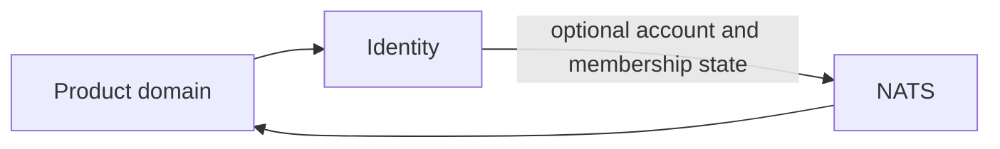

# Aperitif

A Kubernetes foundation for SaaS products built from independently deployable
domains.

Aperitif provides `Identity`, a product-agnostic boundary for authentication,
accounts, and generic membership. Product domains integrate with Identity and
own their vocabulary, workflows, data, and commercial model.

## Included domains

| Domain | Provides |
| --- | --- |
| [Identity](docs/domains.md#identity) | Passkeys, sessions, access tokens, JWKS, accounts, generic membership, and current-state feeds |
| [Auth](domains/auth/README.md) and [Accounts](domains/accounts/README.md) (legacy references only) | Runnable comparison and regression implementations; not for new product dependencies |



A domain owns its database, migrations, API, contracts and Kubernetes manifests.
It exports state through versioned HTTP or NATS contracts; it does not read
another domain’s database.

## Develop

Install the project tools:

```sh
brew bundle
```

Every domain has the same local interface:

| Command                          | Action                                                     |
| -------------------------------- | ---------------------------------------------------------- |
| `make -C domains/<domain> check` | Run package checks and render manifests                    |
| `make -C domains/<domain> up`    | Start its database, run migrations and deploy its runtime  |
| `make -C domains/<domain> dev`   | Start the same environment with Skaffold development loops |
| `make -C domains/<domain> down`  | Delete the domain’s deployed resources                     |

Install only the cluster capability a scenario needs:

```sh
# Browser and HTTP traffic at http://localhost
kubectl apply -k platform/cluster/ingress/overlays/local

# Outbox Relay, NATS state feeds and projections
kubectl apply -k platform/cluster/event-bus/overlays/local
```

For example:

```sh
make -C domains/identity dev
make -C domains/identity e2e
```

`Auth` and `Accounts` remain runnable only as legacy references. Do not add new
product dependencies or capabilities to them; see
[ADR 0001](docs/adr/0001-identity-is-the-canonical-development-boundary.md).

## Repository

```text
domains/                 business boundaries and deployable workloads
platform/cluster/        optional cluster capabilities: ingress, NATS and observability
platform/runtime/        shared executable infrastructure without domain rules
clusters/prod-eu/        Flux production inventory and release state
docs/                    domain model, operations, extension recipes and roadmap
```

Workload manifests have a portable base and environment overlays. Domain
Skaffold files compose workloads. Flux composes domains and platform
capabilities into a cluster.

## Deployment-ready delivery

Pull requests check changed units. The repository contains a deployment-ready
Flux path, but no environment is currently deployed. When a cluster is
introduced, the intended path is:

```text
master → build immutable SHA image → scan → latest → Flux digest commit → prod-eu
```

Flux would reconcile `master` from `clusters/prod-eu`. Its image automation
would resolve the scanned image digest, commit that release state back to Git,
then apply the matching production overlay.

## Secrets for a future deployed environment

Local overlays use disposable development credentials. Production Secret files are
SOPS-encrypted for the Age recipient selected by [`.sops.yaml`](.sops.yaml).
Private Age identities stay outside Git; bootstrap receives the selected identity
through `SOPS_AGE_KEY_FILE`.
Generate a key using `age`:
```
$ age-keygen --help

$ age-keygen -o key.txt
Public key: age1ql3z7hjy54pw3hyww5ayyfg7zqgvc7w3j2elw8zmrj2kg5sfn9aqmcac8p

$ age-keygen -y key.txt
age1ql3z7hjy54pw3hyww5ayyfg7zqgvc7w3j2elw8zmrj2kg5sfn9aqmcac8p
```

## Documentation

- [Platform guide](docs/README.md) — implemented facts, proposed extensions and examples
- [Domain model](docs/domains.md) — boundaries, contracts and new product domains
- [Operations](docs/operations.md) — local clusters, E2E composition, GitOps and recovery
- [Extension recipes](docs/README.md#proposed-capabilities) — invitations, machine access, personal access tokens and product roles
- [Roadmap](docs/roadmap.md) — remaining foundation work
