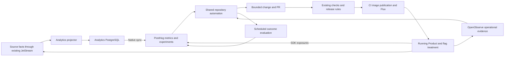

# Analytics and coordinated agents: research and platform fit

Status: Proposed. Research reviewed on 2026-10-30 by three parallel research
agents and a synthesis review. Sources describe a mix of production experience,
newly released capabilities and previews; those distinctions are retained
below. No account entitlement, live integration or deployment was verified.

Scope: This is an optional composed workflow, not the first delivery unit or
a prerequisite for Analytics. Start with the [capability assembly map](analytics-platform.md)
to select independently useful pieces. Reporting, flags, model jobs and agent
tasks can each be adopted without implementing this entire loop.

The current requested target is local/self-hosted. Managed cloud coordination
below is research context, not the selected local deployment. See the
[local placement and consumer plan](analytics-local.md) for current constraints.

## Recommendation after the third research pass

For a selected workflow needing all these capabilities, PostHog Cloud, an
Analytics-owned PostgreSQL read model and a contract-aware JetStream projector
form one candidate assembly. OpenObserve remains the operational telemetry
system. Neither PostHog nor an agent coordinator is required for a SQL report
or analysis job against the owned data.

If the broader loop is selected, evaluate **shared GitHub Copilot Automations
as a coordination candidate**, reusing the existing code/CI environment.
GitHub announced the relevant triggers, chaining and tools on October 28,
2026. Shared availability is still rolling out and must be checked before
implementation. This is an evidence-based product selection for a pilot,
not a claim that an integrated production agent system already exists here.

The ownership remains simple:

| Owner/system | Responsibility |
| --- | --- |
| Source Product | Authoritative facts, behavior, permissions and flag placement |
| Analytics / PostHog | Validated analytical data, metrics, product findings, experiments and measured outcomes |
| OpenObserve | Operational evidence and fast health signals |
| Repository-owned agent automations | Bounded investigation, implementation and follow-up tasks |
| CI / Flux and repository release policy | Verification, permitted promotion, deployment state and recovery |

One coordinated workflow can span these tools without making Analytics a
central authority over every Product. Choose one agent coordinator. PostHog's
native autonomous PR generation stays off if GitHub owns this work.

## What large companies actually demonstrate

| Primary source, date and status | Evidence | Application to this platform |
| --- | --- | --- |
| [Uber Software Factory, August 27, 2026](https://www.uber.com/us/en/blog/efficient-software-factory/) — internal production experience | Managed agents handle code review, CI repair, E2E changes with visual verification, on-call triage and maintenance. Quality and cost are measured per managed workload. | Buy the execution/coordination runtime. Give it useful context and executable checks. High agent PR attribution is not evidence of unsupervised production deployment. |
| [Spotify Honk / developer experience, June 3, 2026](https://engineering.atspotify.com/2026/6/code-with-claude-coding-is-no-longer-the-constraint) — internal production tooling | Honk fits into Fleetshift and existing CI. Consistent technologies/patterns improve agent results. The millions of automated maintenance PRs also include deterministic automation. | Preserve the existing domain/workload conventions and CI. Installing Backstage/Fleetshift or reproducing Honk is not needed for our first workflow. |
| [Spotify verification loops, December 9, 2025](https://engineering.atspotify.com/2025/12/feedback-loops-background-coding-agents-part-3) — internal engineering account | Independent verifiers check builds/tests, with a separate scope judge. Passing CI can still accompany a functionally incorrect change. | Keep the coding task bounded and verify the result independently. Domain checks and integration evidence remain authoritative; another agent agreeing is insufficient. |
| [Google find–fix–deploy pipeline, October 26, 2026](https://cloud.google.com/transform/how-google-does-it-using-agents-help-find-track-and-fix-vulnerabilities) — internal production program | Discovery, validation, sandboxed remediation and monitored release are distinct stages. The account includes engineering review and SRE-observed rollout. | Separate evidence, proposed change and release execution. The article is not a product that installs a Flux integration. |
| [Netflix Data Canary, February 6, 2026](https://netflixtechblog.com/the-data-canary-how-netflix-validates-catalog-metadata-18b699d58e36) — internal production system | Bad transformed data escaped a code-only canary. Netflix added validation of resulting data and tested that validation with controlled failures. | Validate agent-produced data, configuration and model output as well as code. Do not copy Netflix's infrastructure to enforce a few concrete invariants. |

The transferable pattern is bounded work with real feedback: evidence → task →
change → independent verification → release → observed outcome. There is no
evidence here that an open-ended conversation among many agents substitutes
for contracts, checks or valid experiments.

## Available products and material limits

### GitHub Copilot Automations: proposed coordination default

The [October 28 tools and triggers release](https://github.blog/changelog/2026-10-28-new-tools-triggers-and-cost-controls-for-copilot-automations/)
documents external REST triggers, schedules/GitHub events, selected custom MCP
tools, automation success/failure chaining, explicit PR merge/retry tools and
AI-credit limits. It uses configured prompts, triggers and tools; it is not
the separate Markdown-to-Actions Agentic Workflows compiler.

[Shared automations](https://github.blog/changelog/2026-10-28-build-shared-workflows-for-your-team-with-copilot-automations/)
belong to the repository, act as Copilot and bill its owner. They retain change
history and survive their author's departure. They are rolling out on eligible
Copilot plans; organization repositories also need the corresponding cloud
agent billing policy enabled. Account access and tool availability remain an
implementation prerequisite.

This choice puts engineering work next to its repository and release rules,
while the same automation can read PostHog and operational evidence. It does
not require an agent registry, coordination service, new database or portal.
One automation can perform the initial investigation; split implementation
into a chained task when a different toolset or responsibility is useful.

### PostHog Self-driving: closest integrated alternative

[Self-driving](https://posthog.com/docs/self-driving/setup) is **open beta**.
It provides scheduled Scouts, signals grouped into reports, investigation,
implementation and outcome follow-up. [Scouts](https://posthog.com/docs/self-driving/scouts)
can use shared MCP connectors and repository context. Its
[documented release boundary](https://posthog.com/docs/self-driving/self-improving-loop)
requires review/merge; it explicitly does not send changes to production on
its own. A follow-up metric movement is also not automatically causal proof.

It may be the fastest pilot if GitHub shared automations are unavailable.
Its [workflow AI tasks](https://posthog.com/docs/workflows/ai-tasks) can accept
webhook/scheduled work and pass structured outputs and PR URLs to later steps.
The documented task wait is about three hours, and concurrency saturation can
skip new tasks. This is not an unlimited job queue, and a multi-day experiment
should be checked by later scheduled runs.

Do not enable a second autonomous PR loop alongside the GitHub coordinator.
PostHog's analytics, flags, experiments and MCP remain useful regardless of
which runtime performs engineering work.

### Spotify Confidence Loop: strong direction, additional fit work

[Confidence Loop](https://confidence.spotify.com/confidence-loop) advertises
signals → observations → issues → investigation → fixes, with evidence linked
through the chain. It is **beta/request access**. Its Full autonomy setting
explicitly permits shipping without per-change approval; lower modes retain
review. That claim should not be misreported as universally human-gated.

Direct external signal connectors are described as forthcoming; built-in
analytics/recordings and supported warehouse tables are the current paths.
The [managed Cloud mode](https://confidence.spotify.com/docs/start/confidence-cloud)
also limits custom tables and exports. Its broader warehouse-native mode
supports BigQuery, Snowflake, Redshift and Databricks. No verified native
NATS/PostgreSQL/OpenObserve/Flux delivery loop was established in this review.
It is a compelling product to watch, but changes more of this platform than
the selected path.

### Datadog Bits Code: appropriate for a different telemetry starting point

[Bits Code](https://docs.datadoghq.com/bits_ai/bits_code/) can investigate
operational evidence and propose repository changes; its documentation says
it does not auto-merge PRs/MRs. It is a useful reference for agent handoffs,
but adopting the surrounding Datadog integrations to duplicate OpenObserve
increases the configuration and migration work here.

## Proposed complete loop

The OpenObserve-to-agent edge is an integration to establish, not an existing
reachable cloud endpoint. The diagram describes logical responsibilities,
not new services for every box.

Use an issue/report and PR as the initial durable work record. Retain links
to the source finding, metric/version, task run, code revision, image digest,
actual deployment, flag/experiment revision and measurement window. Later
runs can determine whether work already exists and evaluate the right release.
Agents hand off bounded tasks and results instead of needing a new peer
messaging protocol.

## Platform audit: what exists and what remains

The repository contains deployment configuration, not proof of a running
production environment. Analytics, PostHog integration and agent automations
remain proposals.

1. **Verification exists, enforcement needs checking.**
   [PR/merge-queue checks](../../.github/workflows/checks.yaml) run changed-domain
   checks, manifest validation and image builds. Required branch protection
   remains in the [roadmap](../roadmap.md). Do not assume repository settings
   enforce what YAML merely defines. Analytics checks must follow
   `make -C domains/analytics check`, including a working Docker-compatible
   runtime for integration tests.
2. **The declared release path already automatically advances scanned images.**
   [Publication](../../.github/workflows/publish.yaml) builds on `master`, scans
   the immutable image, then retags its digest as `latest`. It does not
   independently rerun domain checks. The
   [image policy](../../clusters/prod-eu/domains/identity/api.yaml) observes that
   tag's digest; [Flux automation](../../clusters/prod-eu/automation.yaml) writes
   production updates directly to `master`. A merged agent change can therefore
   enter the normal production path without another deployment action.
3. **Release authority must be explicit.** Decide which changes an automation
   may merge under enforced checks and which need review. A merge tool does not
   define that policy. Keep agents on the established GitOps path. No canary
   controller, experiment-gated image promotion or automatic rollback is
   currently declared. Test recovery against the `latest` policy: a temporary
   digest edit can be overwritten by reconciliation. A durable revert or
   deliberate policy change must establish the intended release state.
4. **Operational evidence is private today.** The OpenObserve
   [Service](../../platform/cluster/observability/base/openobserve-service.yaml)
   is cluster-internal. Its production
   [NetworkPolicy](../../platform/cluster/observability/overlays/prod-eu/openobserve-networkpolicy.yaml)
   admits collector traffic, not arbitrary cloud agents. Cloud access needs a
   deliberate supported path. Start with bounded alert evidence via an
   external trigger integration; test schema/authentication mapping rather
   than promising a zero-configuration connector.
5. **Native MCP exists, with an edition-specific authorization limit.**
   OpenObserve [v0.92.2](https://github.com/openobserve/openobserve/releases/tag/v0.92.2),
   pinned here, includes an MCP fix. Validate its actual tools against current
   [MCP documentation](https://openobserve.ai/docs/integration/ai/mcp/).
   OSS calls run with the connected account's full privileges, including
   destructive operations; granular custom-role permissions are Enterprise/
   Cloud features. A dedicated OSS user or client-side tool hiding does not
   establish a read-only authorization boundary. Use appropriately enforced
   access for deeper unattended queries; no new telemetry platform is required.
6. **Data synchronization is not a workflow event.** Native PostgreSQL-source
   rows do not automatically become captured-event triggers. Use a scheduled
   query/automation for warehouse findings. Keep operational decisions on the
   faster telemetry path, and wait for sync and conversion windows before
   judging business effects.
7. **The first useful facts still need instrumentation.** Existing public
   inputs are account and initial-owner membership snapshots. A real product
   outcome, eligibility/exposure and suitable historical coverage are missing.
   An agent cannot infer them reliably from current state or sampled logs.

## Acceptance if the complete loop is selected

These checks apply to the full composition, not to every component's first
release. Select one Product outcome and one bounded class of change. That
composition must:

- Ingest an authoritative fact through the normal source contract and replay
  it without inflating results; expose its coverage/freshness in PostHog.
- Produce an evidence-backed investigation and a narrowly scoped PR. Verify
  that the selected runtime can run relevant checks or obtain their results
  from CI; do not assume its sandbox has a Docker-compatible runtime.
- Demonstrate an allowed merge and actual Flux rollout, recording the real
  release state rather than treating an opened PR as a shipped improvement.
- Exercise the selected flag fallback, operational regression response and
  durable recovery path.
- Revisit the correct experiment after a mature measurement window. Check
  assignment/exposure validity, source completeness and independent outcomes.
- Handle duplicate signals, missing task output, failed checks, runtime limits
  and stale measurements without repeated PRs or repeated production actions.

Measure completed useful work, correctness, time to decision, regressions,
human effort and cost per completed outcome. PR count and token consumption
alone do not establish value.

The pilot's required custom code is the domain projector and any irreducible
external-trigger mapping. Shared prompts/tool configuration and existing
CI/Flux policy supply coordination and delivery. Add another service or
framework only when that concrete loop proves it is missing.
