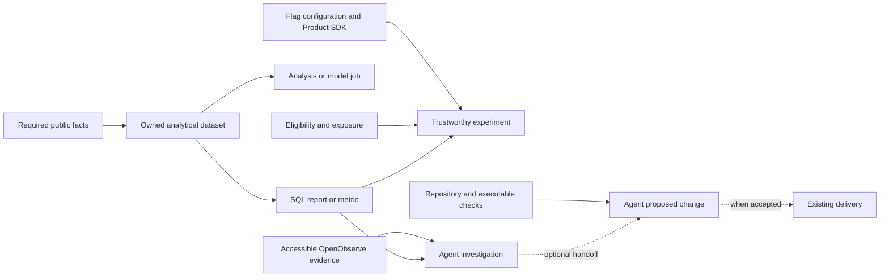

# Analytics and enabling capabilities

Status: Proposed; revised after a capability-boundary review on 2026-10-30.
No workloads, integrations or new domains are implemented by this document.
This is an assembly map, not a requirement to deliver the complete agent loop.

Current deployment target: **local/self-hosted**. The
[local deployment and durable-consumer plan](analytics-local.md) records the
placement and message handling. The PostHog Cloud references below remain
research options; Cloud features are not assumed to exist in its local edition.

The [first-principles guide](analytics-primer.md) explains measurement and storage
before product selection. For a reporting use case, its smallest local assembly
is a projector, PostgreSQL and a Metabase interface; experimentation remains a
separately adopted capability.

## Domain decision

Keep **Identity + Product domains + optional Analytics** as the justified
business boundaries. Add capabilities within them when they have a useful
consumer. Reuse the existing platform and managed engineering tools.

A component, deployable workload and domain are different things. PostgreSQL,
PostHog, a projector and an agent runtime do not each become domains. A domain
owns a cohesive capability and its data, logic, supported interfaces and
lifecycle. Here, baseline/core means reusable enabling capabilities; which
business domain is competitively core depends on the actual Product.

| Boundary | Owns | Current position |
| --- | --- | --- |
| Identity | Identity proofs, accounts, generic membership and its public feeds | Implemented; reuse its supported contracts |
| Product domain(s) | User journeys, business rules, permissions/entitlements, authoritative outcomes and treatment execution | Each Product owns its vocabulary; no generic Product implementation is implied |
| Analytics | Consumed projections, retained analytical facts, datasets, metrics, reports and analytical results | Proposed optional domain; begin with a useful dataset/report |
| Experimentation | Experiment design, shared metric analysis and experiment administration | Optional Analytics capability initially; Products place flags, execute treatments and instrument exposure |
| Modelling and AI analysis | Training/evaluation, analytical models and batch outputs | Optional Analytics workloads initially; Product-specific online decisions remain with their owner |
| Operational visibility | Telemetry ingestion, querying and alerts | Existing platform capability: OTel/OpenObserve |
| Engineering automation | Repository investigation/coding tasks and handoffs | Optional tooling; a managed/runtime choice when a task needs it |
| Delivery | Checks, images, GitOps deployment and recovery | Existing engineering/platform capability: CI/Flux |

Do not create Agent, Warehouse, Feature Flags, Deployment or Observability
business domains merely to mirror the available tools. A future Automation,
Experimentation or prediction domain needs evidence of distinct business
semantics, ownership and lifecycle.

## Components that can be assembled independently

These are capability choices, not an installation checklist. Sharing a managed
application does not require enabling all its features at once.

| Capability | Smallest concrete assembly | Inputs and outputs | First independent value |
| --- | --- | --- | --- |
| Public facts | Producer-owned contract and transactional publisher; existing outbox/relay when required | Authoritative operation → supported fact/current-state feed | Another domain can consume the needed meaning reliably |
| Analytical data | One contract-aware JetStream projector + Analytics-owned PostgreSQL + migrations | Public facts/snapshots → retained facts/current dimensions | One queryable dataset with explicit coverage |
| Reports and metrics | Owned SQL/views and an existing query/report interface | Dataset + metric definition → useful answer | A report that informs a named decision |
| Managed analytical workspace | PostHog Cloud native source sync, SQL/views/dashboards when useful | Approved Analytics tables → managed reports and explorations | Shared analysis without operating another warehouse/BI server |
| Feature control | A supported flag service/SDK + Product-local attributes and defaults | Background definitions → local flag/variant decision | A guarded or gradual feature release |
| Experimentation | Assignment/flags + eligibility/exposure + trusted outcomes + metric/statistical analysis | Experimental population and observations → measured effect | A valid A/A check and a useful A/B decision |
| Analysis and modelling | Reviewed SQL/Python job; existing Job/CronJob when scheduled | Reproducible dataset/cutoff + code → evaluated result/model | A useful analysis or batch prediction |
| Agent investigation | One task runtime + reachable, permitted evidence tools | Bounded question and evidence → traceable finding | Investigation or recommendation without code/release privileges |
| Agent implementation | Repository task runtime + executable checks | Specific task → verified proposed change/PR | CI repair, maintenance or a bounded product change |
| Permitted delivery | Existing CI/image publication/Flux with the selected release policy | Accepted revision → identifiable running release | Repeatable delivery and recovery, with or without agents |

Managed dependencies need no placeholder containers. Several consumers can
share one ingestion workload; each independent pipeline still owns its own
progress. A capability may need only configuration in an existing service,
not another Deployment or repository directory.

## Dependency map

There is no mandatory path through every capability:

The arrows express prerequisites or optional handoffs, not services to build.
In particular:

- Flags do not require an Analytics projector or warehouse.
- Reports do not require flags, experiments or agents.
- A model can run on the owned dataset before PostHog or a columnar warehouse.
- Engineering agents can repair CI or maintain a repository without Analytics.
- Operational investigation can use OpenObserve without product measurement.
- Investigation does not require permission to implement, merge or deploy.
- The complete improvement loop is a later composition, not the definition of
  any individual capability.

For example, reporting is facts + analytical data + a query/report. A guarded
release is Product behavior + flag control + delivery. An A/B test adds common
eligibility/exposure and trustworthy outcomes. Agent-assisted maintenance is
a repository task + verification, with delivery only if the change is accepted.
Each can be useful without the others.

## Interfaces that keep assembly straightforward

Follow [the existing domain contract](../domains.md). Introduce an interface
for its real consumer, not a universal integration framework.

- Source owners define and publish facts. Analytics validates the exact producer
  contract and actual NATS subject; its receipt/effects commit before ACK.
- Immutable facts retain stable source/event identity. Snapshot projections use
  atomic source-version comparisons. Current state is not transition history.
- Analytics exposes supported reports, queries, datasets or results. A future
  separate Automation/Product domain does not read Analytics' private database.
  SQL/Python workloads inside Analytics can use its owned storage directly.
- A managed UI/query tool can be part of Analytics' owned user interface. SCS
  discipline does not require inventing a custom portal. Give each adopted
  capability an accountable owner and a usable supported interface.
- Product flag evaluation uses local context, background configuration and safe
  defaults. Flags do not grant permissions or entitlements.
- Engineering tasks consume evidence and propose actions through the owning
  repository or Product interface. The delivery system executes accepted
  releases. Analytics does not decide authority for every Product.

Use opaque account/actor/resource IDs where the selected facts need them.
Event identity, source version, contract version, metric/model revision and
release revision have different meanings. Add correlation only for the
assembly that needs it; a universal event/property schema or workflow protocol
is not a prerequisite.

## Component selections remain conditional

**Analytical data:** PostgreSQL and native NATS consumers are the lowest-friction
first choice here. One owned database and projector are sufficient for a
retained dataset and SQL report. Follow the existing
[minimal topology and evolution plan](analytics-evolution.md); analytical
storage and orchestration can evolve from measured requirements.

**Managed reporting, flags and experiments:** PostHog Cloud remains a strong
candidate. It separately provides [local flag evaluation](https://posthog.com/docs/feature-flags/local-evaluation),
a [managed analytical workspace](https://posthog.com/docs/data-warehouse), and
[warehouse-backed experiment metrics](https://posthog.com/docs/experiments/data-warehouse).
Adopt only the feature needed. If selected for owned data, use its native
PostgreSQL source rather than a custom exporter. Its capture HTTP 200 is not a
durable database commit, so it does not replace the projector's commit boundary.
The same vendor does not force flags, ingestion and experiments into one release.

**Agent work:** existing supported task runtimes can start with one bounded
investigation or PR. GitHub shared Copilot Automations remains a candidate when
shared schedules/handoffs are needed, subject to its
[current rollout](https://github.blog/changelog/2026-10-28-build-shared-workflows-for-your-team-with-copilot-automations/).
PostHog Self-driving remains an [open-beta alternative](https://posthog.com/docs/self-driving/setup).
Neither is a prerequisite for data, reporting, flags or modelling. Choose one
coordinator if a selected workflow eventually needs one.

**Models:** an ordinary reviewed job is sufficient initially. Add artefact
storage for real outputs and a training/serving service for an actual compute
or latency requirement. Dagster, MLflow, a feature store, GPU serving and an
agent coordinator are not required to run the first useful model.

**Managed versus self-hosted:** select the operating model for each adopted
component. Do not implement parallel provider profiles or migration abstractions
in advance. Source contracts and owned datasets preserve useful options;
changing SQL dialects, assignment algorithms or vendor APIs still takes work.

## Acceptance belongs to each selected capability

| Selected capability | Evidence it works | What it need not prove |
| --- | --- | --- |
| Public fact | Correct authoritative trigger/time, stable retry identity and required delivery behavior | A company-wide event catalogue |
| Analytical data | Duplicate-safe effects, commit-before-ACK recovery, snapshot version handling, coverage and rebuild | A managed UI, experiment or release |
| Report/metric | Defined population/grain/window, correct result, freshness and known source coverage | Feature adoption or autonomous action |
| Flag control | Stable identity, safe cold-start/outage behavior and intended treatment execution | Causal improvement |
| Experiment | Common control/treatment exposure opportunity, correct unit/join, A/A validity and suitable analysis window | Coding agents, model training or automatic deployment |
| Analysis/model | Reproducible retained inputs/cutoff/code, evaluated output and a consumer | An ML platform or experiment service |
| Investigation agent | Evidence-linked answer and demonstrated tool access | Write, merge or production privileges |
| Coding task | Bounded change and independent relevant checks | Automatic merging or a general coordinator |
| Delivery | Enforced release rules, known promoted digest/running state and demonstrated recovery | AI decision-making or an A/B test |

Implement domain validation as `make -C domains/<domain> check`; integration
tests need a working Docker-compatible runtime. These remain planned checks
for a future Analytics implementation, not commands supplied by this document.

## Where a new domain would become justified

Keep boundaries small until experience establishes a split:

- **Experimentation:** a separately accountable program owns experiment policy,
  assignment/analysis interfaces and an independent lifecycle across Products.
- **Automation/work management:** durable business work, approval/case state,
  execution policy and outcomes develop beyond repository chores.
- **A prediction capability:** a coherent Product vocabulary such as fraud or
  recommendations develops its own consumers, latency and lifecycle. Using ML
  or needing a serving container alone is not a domain boundary.

Splitting code deployment for load isolation does not automatically create a
new business domain. Conversely, a real independent owner may justify a domain
while continuing to use the same managed product.

## Research check and current platform limits

The ownership recommendation follows the [SCS characteristics](https://scs-architecture.org/):
autonomous ownership of data, logic and user interface, with asynchronous
collaboration. [Uber DataMesh](https://www.uber.com/us/en/blog/datamesh/) maps
resources and lifecycle to data ownership. Its organization/resource grouping
is not a prescription for a new bounded context per cloud component.
[Spotify separates personalization and experimentation](https://engineering.atspotify.com/2026/1/why-we-use-separate-tech-stacks-for-personalization-and-experimentation)
because serving behavior and evaluating it have different concerns. We can
preserve those concerns as explicit capabilities before creating more domains.
Spotify's [focused engineering conventions](https://engineering.atspotify.com/2026/6/code-with-claude-coding-is-no-longer-the-constraint)
also support reusing this repository's patterns for agent work.

Apply prerequisites only where they matter. The private OpenObserve endpoint
and OSS permission limits matter when connecting a cloud agent; they do not
block a SQL report. Merge enforcement/recovery matters before permitted agent
merges; it does not block a read-only investigation. Current Identity snapshots
provide honestly scoped current dimensions, not a complete activity/conversion
history; missing Product facts block those metrics, not every Analytics use.

The [agent-loop research](analytics-agent-loop.md) remains an illustrative
composition and audit for later use. The next implementation can stop at a
useful dataset, report, flag, investigation or job; it does not need to close
the entire observe → change → deploy → measure loop.
